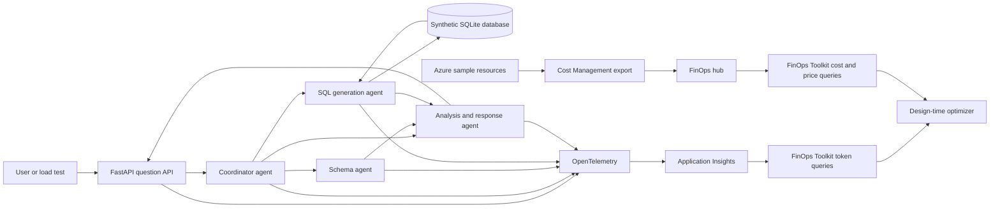

# FinOps multi-agent sample workload architecture

The [hack delivery plan](../project-plan.md) controls the first sandbox demonstration and delivery order. This architecture retains both infrastructure and agent optimization scenarios.

## Status

This document defines a standalone, independently deployable sample workload for developing and demonstrating the FinOps design-time optimizer.

The sample is a multi-agent retail operations assistant that answers natural-language questions over synthetic data. It produces application, agent, token, performance, consumption, and answerability evidence that FinOps Toolkit can analyze.

See the [project plan](./project-plan.md) for implementation phases, backlog, tests, and acceptance criteria.

## Executive summary

The sample directory provides a realistic but bounded environment for autonomous FinOps refactoring. It deploys an HTTP application to Azure Container Apps, uses multiple agents to translate questions into SQL and synthesize answers, and emits OpenTelemetry to Application Insights.

The sample and FinOps Toolkit share source control but retain independent deployment and runtime boundaries:

- Both are built from pinned revisions of `bobjac/finops-toolkit`.
- The sample source, tests, infrastructure, and scripts live under `hack/sample-multi-agent-workload/`.
- Repository-root `.github/workflows/` orchestrates deployment, experiments, and cleanup through separate hub and sample entry points.
- The sample can build, test, and deploy without a FinOps hub.
- FinOps hubs ingest Azure cost data for the sample's configured scope through Cost Management exports.
- FinOps Toolkit tokenomics queries read the sample's Application Insights telemetry.
- The sample never writes directly to core FinOps hub tables.

This architecture supports two optimization families:

1. **Infrastructure optimization:** Container Apps CPU, memory, scaling, and minimum replicas.
2. **Agent optimization:** Model routing, prompt size, schema context, caching, agent handoffs, and token usage.

It also contains one intentional data gap so an answerability analysis agent can propose a schema or service enhancement.

## Goals

- Deploy independently with one documented command.
- Use synthetic data and avoid customer information.
- Exercise multiple cooperating chat agents.
- Support deterministic functional and answer-quality evaluation.
- Emit complete parent and child agent traces.
- Attribute model and token usage by agent, session, question, experiment, and variant.
- Produce measurable Container Apps and AI consumption.
- Support equivalent baseline and candidate deployments.
- Flow Azure cost data into a separately deployed FinOps hub through supported exports.
- Keep sample-specific optimization changes within the sample directory.
- Include an intentional answerability gap that can produce a decision record.
- Remove all sample resources automatically.

## Non-goals

- Production-grade retail functionality.
- Use of real customer, employee, or financial data.
- Autonomous production changes.
- Direct writes into FinOps hub core databases or ingestion tables.
- Invoice reconciliation from a short load test.
- A general-purpose data platform.
- Support for every agent framework or model provider.
- Automatic acceptance of model changes without answer-quality evaluation.

## Scenario

The application represents a fictional retailer named Contoso Outdoor. Users ask operational questions about:

- Orders and order value.
- Product categories.
- Inventory levels.
- Fulfillment status.
- Shipping status.
- Regional performance.

Supported examples:

- "What were the top five product categories by revenue last month?"
- "Which products are below their reorder point?"
- "How many open orders are waiting for shipment?"
- "What is the average fulfillment time by region?"
- "Which orders have missed their promised ship date?"

Intentional unsupported example:

- "Why were shipments delayed after leaving the warehouse?"

The initial schema stores the current shipment status and selected timestamps but does not store carrier milestone history, delay reasons, weather, or route events. The application must return an explicit unable-to-answer result rather than inventing an explanation.

## Application stack

Recommended stack:

| Layer | Technology |
| --- | --- |
| API | Python 3.12 and FastAPI |
| Agent orchestration | Application-defined agent interface using Azure OpenAI chat completions |
| Data access | SQLAlchemy and SQLite |
| Telemetry | OpenTelemetry Python SDK and Azure Monitor exporter |
| Packaging | Docker |
| Azure hosting | Azure Container Apps consumption plan |
| Infrastructure | Bicep |
| Load testing | Azure Load Testing with JMeter |
| Tests | pytest |
| Automation | PowerShell 7 and GitHub Actions |

The agent interface should isolate Azure OpenAI client details so another model endpoint can be substituted without changing orchestration or evaluation.

## Logical architecture



## Agent design

### Coordinator agent

Responsibilities:

- Classify the question.
- Decide whether the question is supported.
- Select the required specialist agents.
- Maintain the parent trace and shared question context.
- Prevent unnecessary agent calls.
- Return an explicit unable-to-answer status when required evidence is unavailable.

### Schema agent

Responsibilities:

- Select the minimum schema context needed for the question.
- Return approved tables, fields, relationships, and business definitions.
- Exclude sensitive or irrelevant metadata.
- Identify when the requested concept is absent from the current data model.

### SQL generation agent

Responsibilities:

- Generate read-only SQLite SQL from approved schema context.
- Use parameter binding when user-supplied values are required.
- Reject write operations and unsupported functions.
- Return generated SQL, parameters, and a confidence indicator.

The application must validate SQL before execution:

- Permit one `SELECT` statement.
- Deny data-definition and data-modification statements.
- Deny multiple statements.
- Apply a row limit.
- Apply an execution timeout.
- Restrict accessible tables.

### Analysis and response agent

Responsibilities:

- Interpret structured query results.
- Answer only from returned data and approved definitions.
- Include important assumptions.
- Return a structured answer status.
- Avoid inferring causes that the data does not support.

### Optional answer verifier

The first implementation can use deterministic validation instead of another model call. Add a verifier agent only when it improves measurable answer quality enough to justify its token cost.

## API contract

### Submit a question

```http
POST /api/questions
Content-Type: application/json
```

```json
{
  "question": "Which products are below their reorder point?",
  "sessionId": "session-01J...",
  "experimentId": "exp-01J...",
  "variant": "baseline"
}
```

Response:

```json
{
  "requestId": "req-01J...",
  "answerStatus": "answered",
  "answer": "Three products are below their reorder point.",
  "data": {
    "columns": [
      "product",
      "onHand",
      "reorderPoint"
    ],
    "rows": []
  },
  "evidence": {
    "generatedSql": "SELECT ...",
    "rowCount": 3
  },
  "limitations": []
}
```

Supported `answerStatus` values:

```text
answered
clarification-required
unable-to-answer
query-rejected
query-failed
dependency-failed
```

### Health endpoints

```text
GET /health
GET /ready
```

`/ready` verifies database initialization, model endpoint configuration, and telemetry exporter readiness without making a billable model call.

## Synthetic data model

### Initial tables

```text
customers
products
inventory
orders
order_items
shipments
```

Recommended columns:

```text
customers
  customer_id
  region
  customer_segment

products
  product_id
  product_name
  category
  unit_price
  reorder_point

inventory
  product_id
  warehouse
  on_hand_quantity
  reserved_quantity
  updated_at

orders
  order_id
  customer_id
  order_date
  promised_ship_date
  shipped_date
  delivered_date
  status
  total_amount

order_items
  order_id
  product_id
  quantity
  unit_price

shipments
  shipment_id
  order_id
  carrier
  current_status
  shipped_at
  delivered_at
```

The schema intentionally excludes:

- Carrier milestone history.
- Route events.
- Delay reason codes.
- Weather events.
- Distribution-center processing events.

Seed data must be deterministic and generated from a fixed seed.

## Answerability evidence

When the application cannot answer, it emits a sanitized event:

```json
{
  "apiVersion": "optimization-harness.io/v1",
  "eventId": "ans-01J...",
  "timestamp": "2026-10-02T16:00:00Z",
  "application": "contoso-outdoor-operations-agent",
  "conversationRef": "hashed-session-reference",
  "questionPattern": "shipment-delay-cause-after-warehouse",
  "questionRef": "protected-content-reference",
  "answerStatus": "unable-to-answer",
  "reasonReportedByApplication": "required-data-not-modeled",
  "generatedQueryRef": null,
  "executionStatus": "not-executed",
  "schemaVersion": "1",
  "experimentId": "exp-01J...",
  "variant": "baseline"
}
```

The ordinary telemetry event contains a normalized question pattern, not raw question text. Local and test environments can store protected fixtures separately.

## OpenTelemetry design

### Trace hierarchy

```text
POST /api/questions
└── coordinator.run
    ├── schema-agent.run
    │   └── gen_ai.chat
    ├── sql-agent.run
    │   ├── gen_ai.chat
    │   └── db.query
    └── analysis-agent.run
        └── gen_ai.chat
```

Required attributes:

```text
service.name
service.version
deployment.environment
optimization.experiment.id
optimization.variant
optimization.workload.name
app.session.id
app.question.pattern
agent.name
agent.role
gen_ai.system
gen_ai.request.model
gen_ai.response.model
gen_ai.usage.input_tokens
gen_ai.usage.output_tokens
gen_ai.usage.cached_input_tokens
```

Use the OpenTelemetry generative AI semantic conventions supported by the selected SDK. Keep custom attributes under a stable application or optimization namespace.

Never include:

- Model credentials.
- Raw protected questions.
- Full prompts.
- Database rows.
- Personal data.

## Functional evaluation

The repository contains a golden evaluation set:

```text
tests/evaluation/questions.json
```

Each case defines:

- Question ID.
- Question text or protected fixture reference.
- Expected answer status.
- Allowed tables.
- Expected normalized SQL shape or result.
- Expected result values.
- Maximum agent calls.
- Maximum input and output tokens when applicable.

Example:

```json
{
  "id": "inventory-below-reorder",
  "question": "Which products are below their reorder point?",
  "expectedStatus": "answered",
  "allowedTables": [
    "products",
    "inventory"
  ],
  "expectedRows": [
    {
      "productId": "P-1004"
    }
  ]
}
```

The intentional gap case expects `unable-to-answer` and must fail if the application invents a cause.

## Deployment architecture

Azure resources:

- Resource group.
- Azure Container Registry.
- Log Analytics workspace.
- Application Insights.
- Container Apps environment.
- Container App.
- User-assigned managed identity.
- Azure Load Testing resource.
- Optional storage account for protected test artifacts.

The sample uses an existing Azure OpenAI or supported model endpoint by default. The deployment accepts:

- Model endpoint.
- Primary model deployment.
- Optional lower-cost routing model deployment.
- Tenant and subscription.

The container identity receives only the role required to call the configured model endpoint.

## Bicep structure

```text
infra/
  main.bicep
  modules/
    identity.bicep
    monitoring.bicep
    registry.bicep
    container-apps-environment.bicep
    application.bicep
    load-testing.bicep
  parameters/
    dev.bicepparam
    experiment.bicepparam
```

Baseline and candidate use the same modules. Variant parameters control:

- CPU.
- Memory.
- Minimum and maximum replicas.
- Concurrency.
- Primary and routing models.
- Schema-context strategy.
- Agent-call limits.

## Resource tagging

Apply these tags to every supported Azure resource:

```text
ftk-tool = design-time-optimizer-sample
ftk-workload = contoso-outdoor-agent
optimization-experiment-id = <experiment-id>
optimization-variant = baseline | candidate
repository = <owner/repository>
revision = <commit>
expires-on = <ISO date>
```

Use a stable application tag outside experiments so FinOps hub queries can track the workload over time.

## FinOps Toolkit integration

### Cost flow

The sample does not send cost rows directly to FinOps hubs.

1. Deploy the FinOps hub independently.
2. Configure Cost Management exports for the sample subscription or enclosing scope.
3. Deploy the sample with stable workload and experiment tags.
4. Allow the hub ingestion pipeline to process exported cost data.
5. Query `Costs()` and `Prices()` through supported FinOps Toolkit tools.

Cost data can arrive hours later. Overnight experiments should use measured consumption and applicable prices for immediate decisions, then reconcile with ingested cost when available.

### Agent telemetry flow

The sample exports OpenTelemetry to Application Insights. FinOps Toolkit tokenomics queries use:

- Application Insights resource ID.
- Experiment ID.
- Variant.
- Session.
- Parent and child agent spans.
- Model and token attributes.

The FinOps Toolkit deployment must parameterize the Application Insights source rather than embed a sample-specific resource ID.

### Experiment result flow

The MVP stores experiment results as:

- GitHub Actions artifacts.
- Pull-request comments.
- JSON and Markdown files in the workflow artifact directory.

A future bounded tool such as `record_optimization_experiment` can publish normalized summaries to a dedicated table or store. It must not write to `Costs()`, `Prices()`, or core ingestion tables.

## Independent deployment commands

Recommended commands:

```powershell
./eng/Initialize-Local.ps1
./eng/Build-Sample.ps1
./eng/Test-Sample.ps1
./eng/Deploy-Sample.ps1 `
    -SubscriptionId <subscription-id> `
    -Location eastus2 `
    -ModelEndpoint <endpoint> `
    -PrimaryModelDeployment <deployment>
./eng/Run-Evaluation.ps1 -Environment dev
./eng/Run-LoadTest.ps1 -Environment dev
./eng/Collect-Evidence.ps1 -Environment dev
./eng/Remove-Sample.ps1 -Environment dev
```

Run these planned entry scripts from `hack/sample-multi-agent-workload/`. Repository-root GitHub Actions workflows must set that working directory or invoke the scripts through their repository-relative paths.

FinOps Toolkit connection settings are optional inputs used by evidence collection, not application startup.

## First optimization experiment

### Container Apps rightsizing

| Setting | Baseline | Candidate |
| --- | ---: | ---: |
| CPU | 1 vCPU | 0.5 vCPU |
| Memory | 2 GiB | 1 GiB |
| Minimum replicas | 1 | 1 |
| Maximum replicas | 1 | 1 |
| Application image | Same | Same |
| Agent configuration | Same | Same |

Required evidence:

- Successful question count.
- P50 and P95 latency.
- Error rate.
- Throughput.
- Active duration.
- Allocated vCPU-seconds.
- Allocated GiB-seconds.
- Agent calls and tokens to prove application equivalence.

Accept only when functional and answer-quality evaluation passes and every performance guardrail passes.

## Follow-on optimization experiments

### Model routing

Use a lower-cost model for question classification or schema selection while preserving the primary model for complex SQL and analysis.

### Schema-context reduction

Send only relevant tables and fields instead of the complete schema on every agent call.

### Schema-context caching

Cache stable compact schema context and measure cached-token or prompt-token reduction.

### Agent-handoff reduction

Skip specialist calls for deterministic question categories when doing so preserves answer quality.

### Scaling

Evaluate minimum replicas, concurrency, and scale-to-zero after the fixed-replica baseline is stable.

## Security

- Use synthetic data.
- Use managed identity for model access.
- Keep model credentials out of application settings.
- Permit read-only SQL only.
- Limit query rows and execution time.
- Protect raw questions and generated SQL when required.
- Use isolated experiment resources.
- Deny production scope.
- Never expose telemetry connection strings in logs.
- Require approval before Git pushes, deployments, and model changes according to repository policy.

## Reliability and cleanup

- Add `/health` and `/ready`.
- Use retry limits and timeouts for model calls.
- Record dependency failures separately from unable-to-answer events.
- Keep evaluation deterministic.
- Tag every resource with expiration.
- Run cleanup after failed deployment and testing.
- Add a scheduled cleanup workflow.
- Report remaining resources as a failed run.

## Recommended directory structure

Sample paths below are relative to the repository root. GitHub Actions workflows belong only in the root `.github/workflows/`, with sample commands run from `hack/sample-multi-agent-workload/`.

```text
hack/sample-multi-agent-workload/
  src/
    api/
    agents/
      coordinator.py
      schema_agent.py
      sql_agent.py
      analysis_agent.py
    data/
      schema.sql
      seed.py
    telemetry/
    evaluation/
  tests/
    unit/
    integration/
    evaluation/
      questions.json
    load/
      sample-workload.jmx
  infra/
    main.bicep
    modules/
    parameters/
  eng/
    Initialize-Local.ps1
    Build-Sample.ps1
    Test-Sample.ps1
    Deploy-Sample.ps1
    Run-Evaluation.ps1
    Run-LoadTest.ps1
    Collect-Evidence.ps1
    Remove-Sample.ps1
  experiments/
    container-app-rightsize.experiment.json
    model-routing.experiment.json
  Dockerfile
  pyproject.toml
  README.md
  architecture.md
  project-plan.md

.github/workflows/
  <sample-ci-workflow>.yml
  <sandbox-deployment-workflow>.yml
  <optimization-experiment-workflow>.yml
  <sandbox-cleanup-workflow>.yml
```

## Architecture decisions to record

- Python and FastAPI for the sample.
- Application-defined agent interface.
- SQLite synthetic data model.
- Existing model endpoint versus sample-owned deployment.
- OpenTelemetry attribute conventions.
- Raw question and SQL evidence handling.
- Container Apps fixed-replica baseline.
- Cost and token price sources.
- FinOps hub export scope.
- Experiment artifact storage.
- Intentional answerability gap.

## Definition of done

The sample is complete when:

- It builds and tests locally.
- It deploys without a FinOps hub.
- It can connect to a hub deployed from a separate FinOps Toolkit branch.
- At least three agents produce correlated child spans.
- Supported questions pass deterministic evaluation.
- The intentional data-gap question returns `unable-to-answer`.
- Azure Load Testing produces repeatable results.
- Cost and token evidence can be queried by experiment and variant.
- Baseline and candidate deploy from the same Bicep modules.
- The rightsizing experiment produces a valid comparison.
- All sample resources can be removed automatically.
- Sample-specific optimization changes remain within the sample directory; repository-root workflows coordinate experiments.
