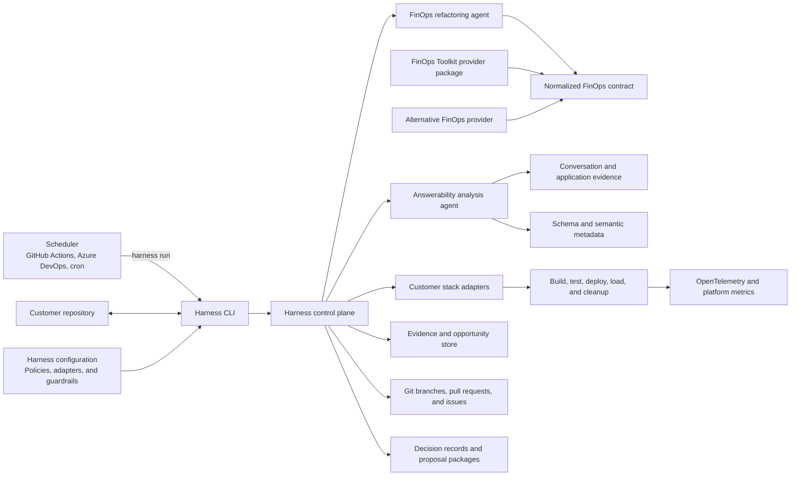
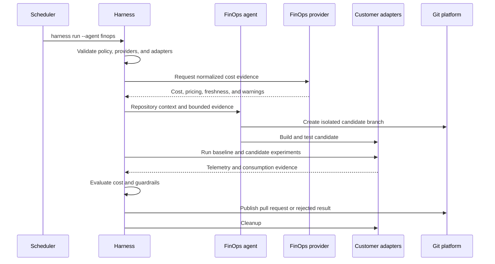
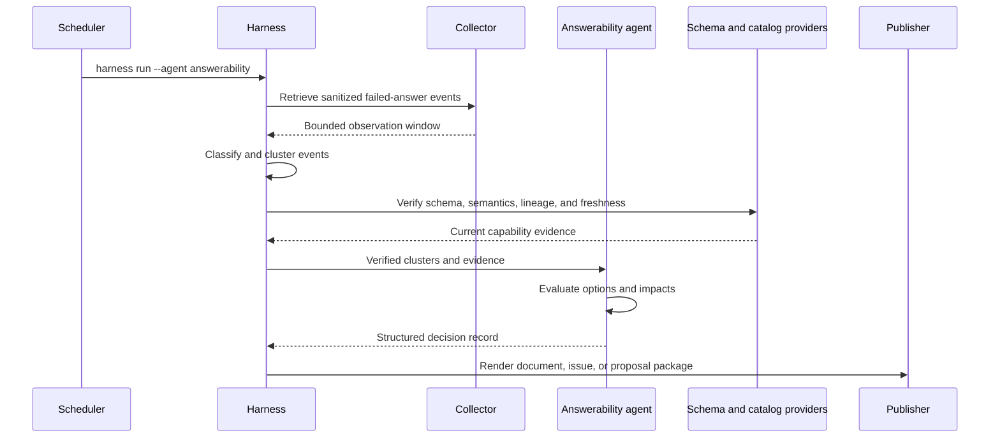

# Autonomous optimization harness architecture

## Status

This document defines the target architecture for a portable autonomous optimization harness that can run from a command line, a scheduled job, GitHub Actions, Azure DevOps, or another automation platform. The harness is a standalone product and must be implemented in its own source-code repository.

The harness supports two initial specialist agents:

- A FinOps refactoring agent that proposes and tests code or infrastructure changes against cost and performance evidence.
- An answerability analysis agent that identifies recurring questions an AI application cannot answer and produces data capability decision records.

See the [project plan](./project-plan.md) for delivery phases, backlog, milestones, and acceptance criteria.

## Portability and coding-agent handoff

This document and its project plan are designed to be copied together into a new or empty repository. They do not require access to the repository where they were originally drafted.

A coding agent starting the new repository should:

1. Read both documents before creating implementation files.
2. Treat the architecture principles, repository boundaries, public contracts, security controls, and autonomy limits as requirements.
3. Create a dependency-aware implementation backlog from the project-plan IDs.
4. Bootstrap the harness repository described in this document.
5. Implement mock and file-based providers before integrating an external product.
6. Use a sample customer application to prove the adapter contract.
7. Keep every external provider optional and replaceable.
8. Stop and record an architecture decision when an open question blocks a public contract or security boundary.

The coding agent must not:

- Assume FinOps Toolkit source code is present in the harness repository.
- Copy FinOps Toolkit internals into the harness core.
- Make the first build depend on access to a live FinOps platform.
- Place customer-specific build or deployment logic in the harness.
- Combine the two specialist agents into one prompt or permission set.

The first executable vertical slice should use:

- A mock FinOps provider with deterministic fixtures.
- A file-based failed-answer event provider.
- A file-based schema and catalog provider.
- A sample customer repository with local adapters.
- A local Git adapter or test repository.
- Markdown and JSON artifact publishers.

External integrations can replace these components after the public contracts pass their tests.

## Executive summary

The autonomous optimization harness is a separate, stack-neutral product. It coordinates evidence collection, specialist agents, controlled experiments, policy enforcement, and delivery of code or architecture recommendations. A customer invokes one command, and the harness runs in the customer's repository using adapters that match the customer's application stack and delivery process.

The harness does not own every source of domain data. It loads provider packages that implement stable capability contracts. For example, the FinOps Toolkit repository owns a FinOps Toolkit provider package containing its supported KQL, connection guidance, response normalization, and provider-specific agent grounding. The harness consumes that package through a normalized FinOps contract. A customer that uses another FinOps platform installs a different provider without changing the core optimization agent.

The recommended responsibility split is:

| Product boundary | Primary responsibility |
| --- | --- |
| Harness repository | Portable CLI, workflow engine, generic specialist agents, policy, evidence, experiments, Git integration, and document rendering |
| External FinOps Toolkit repository | Optional FinOps Toolkit data provider, KQL, FinOps hub connection logic, provider-specific grounding, tests, and release package |
| Customer repository | Build, test, deploy, load, telemetry, cleanup adapters, requirements, guardrails, and approved optimization scope |
| Optional customer integration repository | Private connectors, proprietary schemas, organization policies, and solution-integrator extensions |

This split keeps the harness portable, keeps FinOps Toolkit knowledge close to the toolkit, and prevents provider-specific schemas from leaking into the generic agents.

## Goals

- Start an optimization run with one noninteractive command.
- Run from any scheduler or automation platform that can execute a container or command.
- Support multiple specialist agents without combining their prompts, permissions, or decision criteria.
- Keep application build and deployment logic in the customer's stack.
- Load FinOps and other domain capabilities through versioned provider contracts.
- Produce attributable evidence for every recommendation.
- Support code-producing and document-producing workflows.
- Preserve human approval for merges, production changes, schema changes, and material architecture decisions.
- Make provider, agent, collector, evaluator, and publisher components independently replaceable.

## Non-goals

- A universal build system that replaces customer toolchains.
- Autonomous production deployment or database migration.
- Automatic merge into protected branches.
- A requirement that every customer use FinOps hubs or Azure.
- Treating application traces as complete invoice data.
- Allowing agents to issue unrestricted SQL, KQL, cloud, or shell commands.
- Creating architecture proposals from isolated or unverified user questions.

## Architecture principles

1. **Keep the harness stack-neutral.** Customer commands and adapters define how to build, test, deploy, measure, and clean up a workload.
2. **Separate agents by responsibility.** Agents share infrastructure but not prompts, permissions, tools, or success criteria.
3. **Normalize capabilities, not source schemas.** Generic agents consume stable contracts while provider packages translate source-specific data.
4. **Use evidence before action.** Every code change or decision record traces back to observations, classifications, and validation results.
5. **Make autonomy bounded.** Policy limits changed paths, candidate count, resource scope, runtime, cost, and allowed tool calls.
6. **Fail closed.** Missing prices, incomplete telemetry, invalid configuration, denied access, or failed cleanup cannot produce a success result.
7. **Keep schedulers thin.** GitHub Actions or another scheduler starts the harness and publishes its exit status; orchestration logic stays in the harness.
8. **Prefer portable artifacts.** Configuration, evidence, opportunities, experiment results, and decision records use versioned JSON or YAML schemas.
9. **Treat Markdown as a rendering.** Machine-readable records remain the system of record and can render into pull requests, issues, proposals, or documents.
10. **Require review at irreversible boundaries.** Merges, production changes, schema changes, and new services require explicit approval.

## System context



## Product and repository boundaries

### Harness repository

The harness repository is the portable product. It must not depend directly on FinOps hub table names, a customer's database schema, or a specific application framework.

It owns:

- The `harness` command-line interface.
- Configuration and schema validation.
- Run lifecycle and resumable state.
- Agent registration and isolation.
- Provider and adapter discovery.
- Policy evaluation and approval gates.
- Evidence, opportunity, experiment, and decision-record schemas.
- Git branch, commit, push, pull-request, and issue adapters.
- Generic FinOps optimization reasoning.
- Generic answerability analysis and failure classification.
- Experiment comparison and confidence rules.
- Document, pull-request, issue, and artifact publishers.
- Audit telemetry and structured logs.
- Container packaging and scheduler examples.

It does not own:

- FinOps Toolkit KQL or FinOps hub schema details.
- Customer-specific build and deployment commands.
- Proprietary application schemas or business definitions.
- Production credentials.
- Customer-specific infrastructure templates unless used as samples.

### External FinOps Toolkit repository

The external FinOps Toolkit repository owns the supported integration between the harness and FinOps hubs. The harness repository consumes only a released provider package and its public schemas. It must not import FinOps Toolkit source files or require a sibling checkout.

It should own:

- A versioned FinOps Toolkit provider manifest.
- Supported KQL templates and queries.
- FinOps hub connection and environment configuration.
- Translation from FinOps hub results into normalized FinOps capability responses.
- Provider-specific freshness, pricing, currency, and scope rules.
- Provider-specific error messages and diagnostics.
- FinOps Toolkit skill or grounding content needed to interpret hub concepts.
- Contract tests against representative FinOps hub results.
- Compatibility metadata for supported toolkit and harness versions.
- A release artifact or package that the harness can install.

It should not own:

- The generic nightly orchestration engine.
- Customer branch lifecycle.
- Customer build, test, and deployment adapters.
- The generic cost optimization agent.
- The answerability analysis agent.
- GitHub-specific scheduling logic beyond optional usage examples.

### Customer repository

The customer repository owns the executable truth for the workload. The harness reads a small configuration directory and invokes approved commands rather than attempting to infer every build or deployment process.

It should contain:

```text
.optimization-harness/
  harness.yaml
  policy.yaml
  workloads/
    checkout-api.yaml
  adapters/
    build
    test
    deploy
    load
    collect
    cleanup
  context/
    requirements.md
    architecture.md
    data-glossary.md
```

The customer owns:

- Functional and nonfunctional requirements.
- Workload units and service-level objectives.
- Build, test, deploy, load-test, and cleanup commands.
- OpenTelemetry instrumentation and correlation.
- Allowed and excluded paths.
- Resource, time, and cost limits.
- Test data and privacy classification.
- Required reviewers and approval boundaries.
- Domain terminology, semantic models, and data ownership.

### Optional integration repository

Some customers or solution integrators need private extensions that should not live in the harness or an open-source provider repository. A separate private integration repository can package:

- Proprietary FinOps platform providers.
- Customer-specific data catalog connectors.
- Private decision-record templates.
- Organization policy packs.
- Internal issue-tracker publishers.
- Reusable adapters for an enterprise application platform.

The integration package must use the same public contracts as open-source providers.

## Separate generic agents from provider integrations

The harness should not ship a different complete FinOps optimization agent for every cost platform. That model would duplicate prompts, policies, tests, and optimization behavior.

Use this separation instead:

| Component | Owner | Responsibility |
| --- | --- | --- |
| Generic FinOps refactoring agent | Harness | Form hypotheses, inspect code, request normalized cost evidence, implement bounded candidates, and evaluate results |
| FinOps capability contract | Harness | Define stable tools and response schemas independent of a provider |
| FinOps Toolkit provider | FinOps Toolkit | Translate supported FinOps hub data into the normalized contract |
| Alternative FinOps provider | Provider owner | Translate another platform into the same normalized contract |
| Provider grounding extension | Provider owner | Explain provider-specific concepts that cannot be normalized safely |

A provider-specific subagent is optional. Add one only when the provider requires substantial source-specific interpretation. The generic FinOps agent remains the coordinator and receives normalized results.

## Harness command-line interface

The CLI is the stable automation entry point. It must support noninteractive execution and deterministic exit codes.

```text
harness init
harness validate
harness providers list
harness run --agent finops
harness run --agent answerability
harness run --all
harness run --agent finops --workload checkout-api
harness resume --run <run-id>
harness render --run <run-id> --format markdown
harness cleanup --run <run-id>
```

### Command behavior

| Command | Responsibility |
| --- | --- |
| `init` | Create sample configuration and adapter stubs without overwriting existing files |
| `validate` | Validate configuration, providers, adapters, permissions, schemas, and required tools |
| `providers list` | Show installed providers, capabilities, versions, and configuration status |
| `run` | Start one or more agents and persist the run state |
| `resume` | Continue an interrupted run from a durable checkpoint |
| `render` | Render machine-readable results without rerunning analysis |
| `cleanup` | Remove experiment resources and close incomplete execution state |

The CLI must:

- Avoid interactive prompts when `--non-interactive` or a CI environment is detected.
- Return different exit codes for invalid configuration, failed validation, rejected candidates, provider failure, policy denial, and cleanup failure.
- Write structured logs to standard error and machine-readable results to a configured artifact directory.
- Support local process and container execution.
- Never require a specific scheduler.

## Harness control plane

The control plane coordinates runs but does not perform provider-specific analysis itself.

Core responsibilities:

- Load configuration and resolve secrets by reference.
- Create a run ID and correlation context.
- Discover installed agents, providers, adapters, and publishers.
- Evaluate policy before each sensitive operation.
- Schedule agent stages and enforce concurrency.
- Persist checkpoints and artifacts.
- Track branches, commits, deployments, tests, and cleanup.
- Route opportunities to the correct evaluator and publisher.
- Produce a final run status and audit summary.

The first implementation can run as a local process. It does not require a permanently hosted control-plane service. Durable artifacts can be stored in the scheduler workspace, GitHub artifacts, or a configured object store.

## Agent model

### Common agent contract

Every agent declares:

```yaml
id: finops-refactor
version: 1.0.0
capabilities:
  requires:
    - repository.read
    - finops.cost-summary
    - telemetry.query
  optional:
    - git.branch.write
    - experiment.deploy
outputs:
  - opportunity
  - experiment-result
  - pull-request
permissions:
  default: read-only
```

Each agent receives:

- A bounded task objective.
- Approved repository paths.
- Available capability tools.
- Evidence references rather than unrestricted data dumps.
- Run budget, time limit, and candidate limit.
- Required outputs and evaluation rules.

Each agent must return structured outcomes even when it cannot complete the task.

### FinOps refactoring agent

The FinOps refactoring agent:

1. Reads requirements, architecture, code, infrastructure, and tests.
2. Requests normalized historical cost, utilization, recommendations, and pricing.
3. Identifies a material cost driver.
4. Selects one bounded optimization hypothesis.
5. Creates an isolated branch when policy allows.
6. Implements the candidate in approved paths.
7. Runs baseline and candidate experiments.
8. Compares cost per successful workload unit and nonfunctional guardrails.
9. Keeps successful evidence and rejects invalid or regressive candidates.
10. Publishes a pull request or recommendation according to policy.

Its success criteria are measurable cost improvement, complete required evidence, and no failed functional, security, reliability, or performance gate.

### Answerability analysis agent

The answerability analysis agent:

1. Reads sanitized failed-answer events.
2. Classifies each failure.
3. Clusters semantically related questions.
4. Verifies whether existing data, semantics, access, or query generation can answer the question.
5. Measures recurrence, affected users, confidence, and business relevance.
6. Identifies the minimum capability needed to close the gap.
7. Evaluates schema, pipeline, semantic-model, API, and service options.
8. Produces a machine-readable decision record.
9. Renders the record as architecture documentation, a proposal input, or backlog items.

Its default permissions are read-only. It does not modify a production schema or create a microservice. An approved decision record can become input to a separate implementation workflow.

### Future implementation agent

A future implementation agent can consume an approved decision record and:

- Create an epic and user stories.
- Generate a branch and implementation plan.
- Implement approved schema, pipeline, API, or service changes.
- Add tests for previously unsupported questions.
- Prove that representative questions can now be answered.

Keeping this role separate prevents the analyst from approving its own architecture proposal.

## Provider architecture

### Capability-based providers

Providers implement named capabilities instead of exposing their native API directly.

Initial FinOps capabilities:

```text
finops.cost-summary
finops.cost-by-resource
finops.recommendations
finops.current-pricing
finops.utilization
finops.estimate-workload-cost
```

Initial answerability capabilities:

```text
conversation.failed-answer-events
conversation.feedback
data.schema
data.semantic-model
data.catalog
data.query-history
data.lineage
```

The harness can load more than one provider for a capability, but configuration must select precedence and prohibit silent mixing of incompatible currencies, scopes, identities, or data classifications.

### Provider manifest

```yaml
apiVersion: optimization-harness.io/v1
kind: Provider
metadata:
  name: finops-toolkit
  version: 15.0.0
spec:
  harnessCompatibility: ">=1.0.0 <2.0.0"
  capabilities:
    - finops.cost-summary
    - finops.cost-by-resource
    - finops.recommendations
    - finops.current-pricing
  runtime:
    type: mcp
    command: npx
    args:
      - -y
      - "@azure/mcp@latest"
      - server
      - start
      - --namespace
      - kusto
      - --read-only
  configurationSchema: schemas/config.schema.json
  responseSchemas: schemas/responses/
  grounding:
    - skills/finops-toolkit/
```

The released implementation can use MCP, a local executable, a container, or HTTPS. The capability and response contracts remain the same.

### FinOps Toolkit provider package

The FinOps Toolkit provider can extend that product's existing agent-plugin packaging rather than duplicate it. The following source layout is an integration recommendation for the external provider repository, not a directory to create in the harness repository:

```text
src/templates/agent-plugin/
  providers/
    optimization-harness-finops/
      provider.yaml
      schemas/
      queries/
      mappings/
      tests/
  skills/
    finops-toolkit/
  .mcp.json
```

The build can package this provider with the existing FinOps Toolkit skill and curated KQL. The provider should return normalized responses and preserve:

- FinOps scope.
- Currency.
- Pricing basis.
- Effective date.
- Data freshness.
- Cost type.
- Source query version.
- Unpriced quantities.
- Warnings and evidence links.

The harness should not know FinOps hub database or table names.

### Alternative FinOps providers

An alternative provider can use:

- Another FinOps platform API.
- FOCUS data in a warehouse.
- Azure Cost Management exports.
- AWS Cost and Usage Reports.
- Google Cloud billing exports.
- A customer-maintained cost allocation system.

The provider must pass the same contract tests. The generic FinOps agent should not change when the provider changes.

## Customer stack adapter contract

The harness invokes customer-approved adapters for workload operations:

```text
build
unit-test
integration-test
deploy
wait-ready
load-test
collect-telemetry
collect-consumption
cleanup
```

Each adapter:

- Receives a JSON request through a file or standard input.
- Returns a versioned JSON response.
- Uses documented exit codes.
- Emits no credentials in logs.
- Is idempotent where practical.
- Accepts a run ID, variant, revision, and artifact directory.
- Reports created resources for cleanup.

Example response:

```json
{
  "apiVersion": "optimization-harness.io/v1",
  "operation": "deploy",
  "runId": "run-01J...",
  "variant": "candidate",
  "status": "succeeded",
  "resources": [
    {
      "provider": "azure",
      "id": "/subscriptions/.../resourceGroups/..."
    }
  ],
  "outputs": {
    "endpoint": "https://candidate.example.test"
  },
  "evidence": []
}
```

This contract lets a .NET customer use PowerShell and Bicep, a Java customer use Maven and Terraform, and a Kubernetes customer use Helm without changing the harness.

## Evidence and opportunity model

### Evidence envelope

```json
{
  "apiVersion": "optimization-harness.io/v1",
  "evidenceId": "ev-01J...",
  "runId": "run-01J...",
  "source": "finops-toolkit",
  "observedAt": "2026-10-02T14:00:00Z",
  "dataThrough": "2026-10-01T23:59:59Z",
  "classification": "customer-confidential",
  "contentRef": "artifacts/evidence/ev-01J....json",
  "integrity": {
    "sha256": "..."
  },
  "warnings": []
}
```

### Opportunity record

```yaml
apiVersion: optimization-harness.io/v1
kind: Opportunity
metadata:
  id: OPP-0042
  runId: run-01J...
spec:
  type: cost-optimization
  confidence: 0.87
  businessImpact: high
  evidence:
    - ev-01J...
  hypothesis: Reduce duplicate dependency calls by caching stable reference data.
  proposedActions: []
status:
  phase: analyzed
```

Supported opportunity types initially include:

- `cost-optimization`
- `data-capability`
- `answerability-quality`
- `reliability-improvement`

## Answerability event and classification

Applications should emit or export a sanitized event when they cannot provide a useful answer:

```json
{
  "eventId": "ans-01J...",
  "timestamp": "2026-10-02T13:45:00Z",
  "application": "customer-data-agent",
  "conversationRef": "hashed-reference",
  "questionRef": "protected-content-reference",
  "answerStatus": "unable-to-answer",
  "reasonReportedByApplication": "insufficient-data",
  "generatedQueryRef": "protected-content-reference",
  "executionStatus": "succeeded-empty",
  "schemaVersion": "2026-09-15",
  "userFeedback": "not-answered"
}
```

The analysis agent must distinguish:

| Classification | Typical response |
| --- | --- |
| Missing source data | Propose collection or integration |
| Missing historical detail | Propose retention or event modeling |
| Missing relationships | Propose keys, dimensions, or semantic relationships |
| Data not ingested | Propose a pipeline |
| Data is stale | Propose freshness and reliability changes |
| Query generation failure | Improve NL2SQL behavior or semantic metadata |
| Ambiguous question | Improve clarification behavior |
| Access denied | Review authorization |
| Safety refusal | Preserve the refusal unless policy is incorrect |
| Dependency failure | Improve reliability |
| Presentation failure | Improve response generation or visualization |

Only verified capability gaps should produce schema or service recommendations.

## Decision records

The canonical decision record is structured and can render into multiple formats:

```yaml
apiVersion: optimization-harness.io/v1
kind: DecisionRecord
metadata:
  id: ADR-DATA-0042
  title: Add shipment milestone history
  status: proposed
spec:
  context:
    observationWindow: 2026-09-15/2026-09-30
    affectedQuestionCount: 37
  problem:
    classification: missing-historical-detail
    currentLimitation: The current model stores only the latest shipment status.
  options:
    - id: extend-order-store
    - id: shipment-history-service
    - id: analytics-event-model
  recommendation:
    option: analytics-event-model
    rationale: Preserves event history without coupling analytical reads to the transaction store.
  impacts:
    security: []
    privacy: []
    reliability: []
    cost: []
  acceptanceCriteria:
    - Historical shipment transition questions can be answered.
    - Tenant isolation is preserved.
```

Renderers can produce:

- Markdown architecture decision records.
- Solution-integrator proposal inputs.
- GitHub issues and epics.
- Azure DevOps work items.
- Coding-agent specifications.
- Data-contract and architecture appendices.

## Execution flows

### FinOps refactoring flow



### Answerability analysis flow



## Scheduler integration

Schedulers should contain only installation, authentication, invocation, artifact upload, and notification.

Example GitHub Actions job:

```yaml
name: Nightly optimization

on:
  schedule:
    - cron: "0 2 * * 1-5"
  workflow_dispatch:

permissions:
  contents: write
  pull-requests: write
  id-token: write

jobs:
  optimize:
    runs-on: ubuntu-latest
    environment: optimization-harness
    steps:
      - uses: actions/checkout@v4
        with:
          fetch-depth: 0
      - name: Run harness
        run: |
          docker run --rm \
            -v "$PWD:/workspace" \
            -w /workspace \
            ghcr.io/example/optimization-harness:1 \
            run --all --non-interactive
      - uses: actions/upload-artifact@v4
        if: always()
        with:
          name: optimization-harness
          path: .optimization-harness/artifacts/
```

The production workflow must pin actions and container digests according to customer policy.

## Configuration

Example customer configuration:

```yaml
apiVersion: optimization-harness.io/v1
kind: HarnessConfiguration

providers:
  finops:
    package: ghcr.io/provider-owner/finops-toolkit-provider:15
    environment: customer-hub
  conversations:
    package: ./providers/application-insights
  schema:
    package: ./providers/customer-data-catalog

agents:
  finops:
    enabled: true
    schedulePolicy: nightly
    maximumCandidates: 2
  answerability:
    enabled: true
    observationWindowDays: 14
    minimumOccurrences: 5
    minimumDistinctUsers: 3

repository:
  baseBranch: main
  allowedPaths:
    - src/
    - infra/
  excludedPaths:
    - security/
    - migrations/

policy:
  allowBranchCreation: true
  allowPullRequestCreation: true
  allowIssueCreation: true
  allowAutomaticMerge: false
  allowProductionChanges: false
```

## Security and governance

### Identity

- Use workload identity federation or managed identity.
- Keep provider identities separate from experiment deployment identities.
- Resolve secrets through the scheduler or an approved secret store.
- Pass secret references, not secret values, through configuration.

### Authorization

- Grant each agent only its declared capabilities.
- Scope provider access to configured accounts, projects, databases, and workspaces.
- Restrict repository writes to isolated branches and approved paths.
- Require environment approval before cloud deployment.
- Prevent arbitrary query execution unless explicitly approved by policy.

### Data protection

- Sanitize conversation logs before agent access.
- Store raw questions, SQL, and result samples behind protected references.
- Minimize personal, customer, billing, and production data in prompts.
- Apply classifications and retention to every evidence artifact.
- Prevent decision records and pull-request comments from containing protected data.

### Supply chain

- Sign provider and harness release artifacts.
- Pin provider versions in customer configuration.
- Publish checksums and software bills of materials.
- Validate provider manifests and schemas before execution.
- Run providers with constrained filesystem, network, and process access.

### Autonomous-change policy

- Never weaken or remove tests to make a candidate pass.
- Never treat missing evidence as a successful optimization.
- Never merge automatically into a protected branch.
- Never modify production schemas from an answerability recommendation.
- Require cleanup after every experiment.
- Record every branch, commit, provider call, deployment, and decision.

## Reliability and failure behavior

| Failure | Required behavior |
| --- | --- |
| Provider is unavailable | Fail the affected capability and preserve a resumable checkpoint |
| Provider response violates its schema | Reject the response and record a contract error |
| Customer adapter fails | Stop dependent stages and run cleanup |
| Agent exceeds its budget | Stop the agent and publish an incomplete result |
| Required evidence is missing | Reject the candidate or withhold the decision recommendation |
| Git push or pull-request creation fails | Preserve the branch and local artifacts for recovery |
| Decision-record rendering fails | Preserve the canonical structured record |
| Cleanup fails | Return a failing exit code and publish remaining resource identifiers |
| Scheduler stops unexpectedly | Resume from the last durable checkpoint |

## Observability and audit

Every event should include:

- Harness run ID.
- Agent ID and version.
- Provider ID and version.
- Repository and revision.
- Opportunity, experiment, and decision-record IDs.
- Tool or adapter operation.
- Policy decision.
- Duration and outcome.
- Evidence references.
- Branch, commit, pull-request, or issue reference.
- Cleanup status.

The harness should emit OpenTelemetry traces, metrics, and structured logs without storing prompts, credentials, or protected evidence by default.

## Recommended harness repository structure

```text
optimization-harness/
  src/
    cli/
    control-plane/
    agents/
      finops-refactor/
      answerability-analysis/
    contracts/
      providers/
      adapters/
      evidence/
      opportunities/
      decisions/
    evaluators/
      cost/
      answerability/
      confidence/
    git/
    policy/
    publishers/
    runtime/
  schemas/
  templates/
    customer-config/
    decision-records/
    github-actions/
  tests/
    unit/
    contract/
    integration/
    end-to-end/
  samples/
    dotnet-azure/
    java-terraform/
    python-agent/
  Dockerfile
  package.json
```

TypeScript on Node.js LTS is the recommended core implementation because the harness needs a portable CLI, strong schema validation, MCP integration, GitHub APIs, process orchestration, and cross-platform packaging. Customer adapters remain language-neutral executables.

## Versioning and compatibility

- Version all public schemas.
- Use semantic versioning for the harness and providers.
- Declare harness compatibility in every provider manifest.
- Keep additive response fields backward compatible within a major version.
- Reject unsupported major versions explicitly.
- Publish provider contract test fixtures.
- Record the exact harness, agent, provider, and schema versions in every run.

## Architecture decisions to record

Create separate architecture decision records for:

- TypeScript and Node.js as the harness runtime.
- Local process versus hosted control plane.
- Provider packaging and distribution.
- MCP versus executable or HTTPS provider transports.
- Durable run-state storage.
- Git provider abstraction.
- Evidence encryption and retention.
- Agent model and coding-agent host.
- Branch and pull-request autonomy.
- Answerability event schema.
- Decision-record schema and renderers.
- Provider trust and signature validation.

## Open questions

- Which coding-agent runtime can run unattended within the required customer security boundary?
- Will the first release support GitHub only, or define a Git provider interface from the start?
- Where should resumable run state live when a scheduler workspace is temporary?
- How are provider packages distributed for private customer environments?
- What minimum sanitized data is required to classify failed answers accurately?
- Which answerability evaluation set proves that an implemented recommendation improved accuracy?
- Which organization owns the normalized FinOps contract?
- Should the FinOps Toolkit provider use the existing Azure MCP server directly or wrap it with narrower capability tools?
- How should solution integrators add proposal templates without forking the harness?
