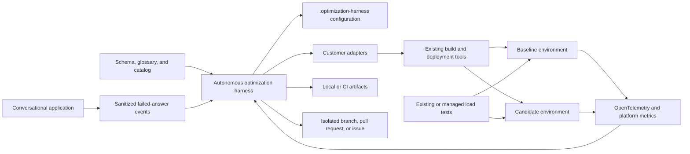

# Customer optimization integration architecture

## Status

This document defines how an existing customer application repository integrates with the autonomous optimization harness without replacing its native toolchain or delivery process.

See the [project plan](./project-plan.md) for the implementation sequence, backlog, tests, and acceptance criteria.

## Executive summary

The customer repository owns the executable truth for its workload. It defines how the application builds, tests, deploys, receives load, emits telemetry, and cleans up temporary resources. The autonomous optimization harness invokes those operations through thin adapters and applies customer-defined policies before any agent can read sensitive evidence or write code.

The integration is intentionally small. It adds configuration, adapter wrappers, workload definitions, telemetry conventions, and optional domain context under `.optimization-harness/`. It does not import harness source code, embed generic agents, or replace the repository's continuous integration.

## Goals

- Integrate an existing application with the harness through stable executable contracts.
- Preserve the customer's stack, tools, and repository conventions.
- Define measurable functional and nonfunctional requirements.
- Correlate code revisions, deployments, load tests, telemetry, and cost evidence.
- Allow bounded optimization branches without granting production access.
- Capture sanitized failed-answer evidence for conversational applications.
- Make every experiment reproducible and removable.
- Keep the repository usable without the harness.

## Non-goals

- Rewriting the application into a preferred framework.
- Replacing existing continuous integration or deployment pipelines.
- Moving customer business logic into the harness.
- Giving agents unrestricted shell, database, cloud, or production access.
- Sending raw customer conversations or query results to ordinary logs.
- Automatically merging changes or modifying production schemas.

## Repository boundary

The customer repository owns:

- Source code and infrastructure-as-code.
- Functional and nonfunctional requirements.
- Unit, integration, security, and performance tests.
- Build and packaging commands.
- Experiment deployment and cleanup commands.
- Representative load profiles and test data.
- OpenTelemetry instrumentation.
- Workload-unit definitions.
- Allowed and excluded optimization paths.
- Data classifications, retention, and reviewer policy.
- Domain glossary, semantic-model descriptions, and architecture context.

The repository does not own:

- Generic optimization or answerability agents.
- Harness run-state management.
- Provider-specific FinOps platform logic.
- Generic decision-record rendering.
- Cross-repository provider contracts.

## Logical architecture



## Recommended repository structure

```text
.optimization-harness/
  harness.yaml
  policy.yaml
  providers.yaml
  workloads/
    primary-api.yaml
  adapters/
    build
    unit-test
    integration-test
    deploy
    wait-ready
    load-test
    collect-telemetry
    collect-consumption
    cleanup
  schemas/
    answerability-event.schema.json
  context/
    requirements.md
    architecture.md
    data-glossary.md
    ownership.md
  fixtures/
    local/
  artifacts/
    .gitkeep
```

Add generated artifacts, local environment settings, and protected evidence to `.gitignore`. Commit configuration, schemas, adapters, requirements, and non-sensitive fixtures.

## Harness configuration

Example:

```yaml
apiVersion: optimization-harness.io/v1
kind: HarnessConfiguration

repository:
  baseBranch: main
  allowedPaths:
    - src/
    - infra/
  excludedPaths:
    - security/
    - migrations/
    - compliance/

agents:
  finops:
    enabled: true
    maximumCandidates: 2
  answerability:
    enabled: true
    observationWindowDays: 14
    minimumOccurrences: 5
    minimumDistinctUsers: 3

providers:
  finops:
    id: organization-finops
  conversations:
    id: application-telemetry
  schema:
    id: customer-data-catalog

workloads:
  - primary-api

artifacts:
  directory: .optimization-harness/artifacts
  retentionDays: 14
```

Configuration contains provider identifiers and secret references, not credentials.

## Policy

Example:

```yaml
apiVersion: optimization-harness.io/v1
kind: HarnessPolicy

git:
  allowBranchCreation: true
  allowCommit: true
  allowPush: true
  allowPullRequestCreation: true
  allowAutomaticMerge: false

cloud:
  allowExperimentDeployment: true
  allowProductionChanges: false
  maximumExperimentMinutes: 120
  maximumConcurrentExperiments: 1
  allowedRegions:
    - eastus2

data:
  allowRawConversationContent: false
  allowQueryTextInProtectedEvidence: true
  evidenceClassification: customer-confidential

answerability:
  allowIssueCreation: true
  allowCodeImplementation: false
  allowSchemaModification: false
```

## Workload specification

Each workload has a measurable unit, test commands, deployment topology, and guardrails.

```yaml
apiVersion: optimization-harness.io/v1
kind: Workload
metadata:
  name: primary-api
spec:
  workloadUnit:
    name: successful-request
    quantity: 1000
  adapters:
    build: adapters/build
    unitTest: adapters/unit-test
    integrationTest: adapters/integration-test
    deploy: adapters/deploy
    waitReady: adapters/wait-ready
    loadTest: adapters/load-test
    collectTelemetry: adapters/collect-telemetry
    collectConsumption: adapters/collect-consumption
    cleanup: adapters/cleanup
  guardrails:
    p95LatencyMs:
      maximum: 500
    errorRatePercent:
      maximum: 1
    throughputPerSecond:
      minimum: 40
  testData:
    profile: synthetic-v1
  cleanup:
    maximumLifetimeMinutes: 120
```

## Adapter contract

Adapters are executable files, scripts, or commands in the customer's stack. They receive a versioned JSON request through standard input or a request file and return a versioned JSON response through standard output or a response file.

Common request fields:

```json
{
  "apiVersion": "optimization-harness.io/v1",
  "operation": "deploy",
  "runId": "run-01J...",
  "experimentId": "exp-01J...",
  "variant": "candidate",
  "revision": "0123456789abcdef",
  "workspace": "/workspace",
  "artifactDirectory": "/workspace/.optimization-harness/artifacts/run-01J..."
}
```

Common response fields:

```json
{
  "apiVersion": "optimization-harness.io/v1",
  "operation": "deploy",
  "status": "succeeded",
  "outputs": {
    "endpoint": "https://candidate.example.test"
  },
  "resources": [
    {
      "provider": "azure",
      "id": "/subscriptions/.../resourceGroups/..."
    }
  ],
  "evidence": [],
  "warnings": []
}
```

Adapters must:

- Validate required input.
- Return nonzero exit codes on failure.
- Avoid interactive prompts in automation.
- Avoid logging credentials.
- Report every created resource.
- Use the run and experiment IDs for correlation.
- Be idempotent where practical.
- Support cleanup after partial deployment.
- Keep ordinary output concise and place diagnostics in the artifact directory.

## Required adapter behavior

| Adapter | Responsibility |
| --- | --- |
| `build` | Restore dependencies, compile, package, and report artifacts |
| `unit-test` | Run deterministic isolated tests |
| `integration-test` | Validate required service interactions |
| `deploy` | Create an isolated baseline or candidate environment |
| `wait-ready` | Verify health and telemetry readiness |
| `load-test` | Run warm-up and measured load with fixed data and demand |
| `collect-telemetry` | Retrieve application performance evidence for exact measurement windows |
| `collect-consumption` | Retrieve billable or estimable consumption quantities |
| `cleanup` | Remove resources from the authoritative resource inventory |

## OpenTelemetry requirements

Application telemetry must support correlation across:

- Harness run.
- Experiment.
- Variant.
- Repository revision.
- Deployment.
- Workload.
- Load-test phase.
- Tenant or test partition when allowed.

Recommended resource attributes:

```text
optimization.run.id
optimization.experiment.id
optimization.variant
service.version
deployment.environment
workload.name
```

Telemetry should capture:

- Request count and success.
- P50 and P95 latency.
- Error rate.
- Throughput.
- Dependency calls and retries.
- Compute or function duration when available.
- Storage, database, network, and AI consumption when applicable.

Do not include credentials, personal data, customer records, or raw prompts as ordinary span attributes.

## Failed-answer events

Conversational applications should emit a sanitized event when they cannot provide a useful answer.

```json
{
  "apiVersion": "optimization-harness.io/v1",
  "eventId": "ans-01J...",
  "timestamp": "2026-10-02T13:45:00Z",
  "application": "customer-data-agent",
  "conversationRef": "hashed-reference",
  "questionRef": "protected-content-reference",
  "answerStatus": "unable-to-answer",
  "reasonReportedByApplication": "insufficient-data",
  "generatedQueryRef": "protected-content-reference",
  "executionStatus": "succeeded-empty",
  "schemaVersion": "2026-09-15",
  "userFeedback": "not-answered",
  "classification": "customer-confidential"
}
```

The application should distinguish:

- No answer was generated.
- The generated query failed.
- The query succeeded with no relevant data.
- Access was denied.
- A safety policy blocked the answer.
- The model requested clarification.
- The user rejected an otherwise valid answer.

Raw question text, generated SQL, and row samples should remain in a protected evidence store and be referenced by ID.

## Schema and domain context

The answerability agent needs a safe representation of current capabilities:

- Tables, fields, types, and descriptions.
- Approved entity relationships.
- Semantic metrics and business terms.
- Data owners.
- Freshness and retention.
- Access classifications.
- Known limitations.
- Lineage to source systems.

Prefer metadata and samples designed for analysis. Do not provide unrestricted production database access when a catalog or schema snapshot is sufficient.

## Git workflow

When policy permits autonomous code candidates:

1. Create a unique branch from the configured base revision.
2. Apply one bounded hypothesis.
3. Restrict changes to allowed paths.
4. Run required tests before deployment.
5. Run baseline and candidate experiments.
6. Create a pull request only when required gates pass.
7. Never merge automatically.
8. Preserve rejected candidates as artifacts or close them according to policy.

Answerability analysis creates decision records or issues by default. It does not create schema or service code unless a later approved workflow enables implementation.

## Security and privacy

- Use workload identity federation or managed identity for automation.
- Keep production and experiment identities separate.
- Deploy experiments to isolated subscriptions, projects, accounts, or resource groups.
- Use synthetic or approved test data.
- Enforce tenant isolation.
- Sanitize conversation evidence before the harness reads it.
- Classify and expire artifacts.
- Require approval for access to protected evidence.
- Prevent secrets and protected content from entering pull-request comments.
- Log policy decisions and sensitive operations.

## Reliability and cleanup

- Persist an authoritative inventory of experiment resources.
- Run cleanup after success, failure, cancellation, and timeout.
- Add expiration tags or equivalent lifecycle controls.
- Provide a scheduled cleanup backstop.
- Fail the harness run when cleanup is incomplete.
- Keep deployment and cleanup commands safe to retry.

## Local developer experience

Developers should be able to run:

```text
./.optimization-harness/adapters/build < request.json
./.optimization-harness/adapters/unit-test < request.json
harness validate
harness run --agent answerability --dry-run
```

Local dry runs should use fixtures and must not require cloud credentials.

## Architecture decisions to record

- Workload unit and guardrails.
- Baseline and candidate deployment topology.
- Test-data strategy.
- OpenTelemetry correlation attributes.
- Failed-answer event storage.
- Protected-evidence access.
- Allowed code and infrastructure paths.
- Experiment identity and cloud scope.
- Cleanup and expiration mechanisms.
- Required reviewers.

## Definition of done

The customer integration is complete when:

- Configuration validates without warnings that block execution.
- Every required adapter passes conformance tests.
- Baseline and candidate environments can be deployed and removed.
- Equivalent load reaches both variants.
- Telemetry can be filtered by run, experiment, and variant.
- Cost-relevant consumption is measurable or explicitly unavailable.
- Failed-answer events are sanitized and classifiable.
- Protected evidence does not appear in ordinary logs or documents.
- Agent writes are limited to approved paths and isolated branches.
- Existing build and deployment workflows continue to work without the harness.
