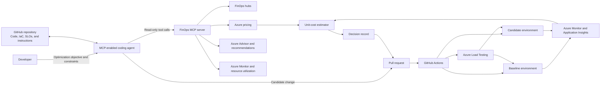
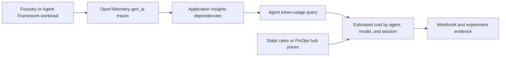
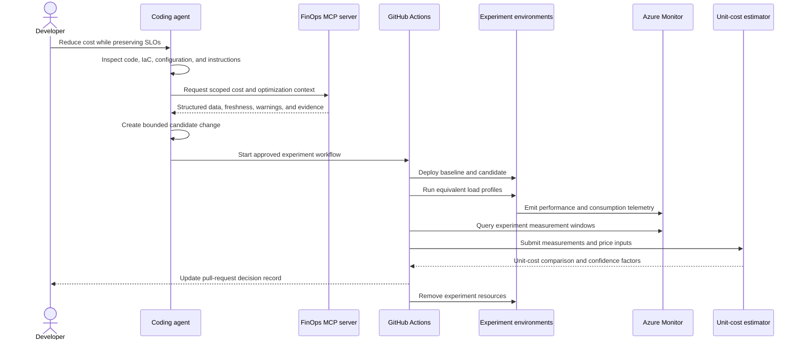

# FinOps design-time optimizer architecture

The [hack delivery plan](../../../project-plan.md) defines the current sandbox scope and first demonstration scenario. This architecture remains the standalone product reference.

## Status

This document defines the target architecture for the standalone FinOps design-time optimizer and the path from a working prototype to a reusable FinOps Toolkit reference implementation.

The initial release validates one workload, one optimization scenario, and one baseline-versus-candidate experiment. It does not provide invoice reconciliation, autonomous production changes, or broad optimization coverage.

See the [project plan](./project-plan.md) for delivery phases, dependencies, and acceptance criteria.

## Standalone product boundary

Everything required to build and run the FinOps design-time optimizer belongs in the FinOps Toolkit repository. The optimizer does not require the autonomous optimization harness or any code from another repository.

This repository owns:

- The FinOps optimization agent and its instructions.
- The FinOps MCP server or bounded MCP tools.
- FinOps hub, pricing, Advisor, and Azure Monitor provider adapters.
- KQL, response schemas, and cost calculations.
- Experiment specifications and validation.
- GitHub Actions orchestration.
- Baseline and candidate deployment support.
- Load testing, telemetry collection, comparison, reporting, and cleanup.
- Samples, tests, documentation, and packaging.

The optimizer can later be exposed to another orchestrator through stable tool or provider contracts, but that integration is optional. No harness-specific manifest, runtime, provider SDK, or control plane is required for standalone execution.

The standalone entry points should include:

- A FinOps Toolkit agent-plugin command for interactive use.
- A noninteractive script or command for CI and scheduled execution.
- A GitHub Actions workflow for repository-native experiments.
- Direct MCP tools that supported coding agents can call.

## Executive summary

The FinOps design-time optimizer brings cost evidence into the software development workflow before a change is merged. An MCP-enabled coding agent reviews application code and infrastructure-as-code, retrieves scoped FinOps context, proposes or implements a bounded optimization, and starts a controlled experiment. The experiment deploys equivalent baseline and candidate environments, applies the same load profile, measures performance and consumption, estimates cost per workload unit, and publishes a decision record to the pull request.

The architecture separates four concerns:

- **Recommendation:** Identify material cost drivers and feasible optimization levers.
- **Experimentation:** Test the baseline and candidate under equivalent conditions.
- **Estimation:** Convert measured consumption into an estimated unit cost.
- **Decision support:** Report savings, performance impact, confidence, assumptions, and tradeoffs.

## Goals

- Run as a self-contained FinOps Toolkit capability without the autonomous optimization harness.
- Give coding agents read-only access to bounded cost, pricing, utilization, and recommendation context.
- Support an explainable repository change or actionable patch.
- Run a repeatable baseline-versus-candidate experiment.
- Compare estimated cost per workload unit while enforcing performance guardrails.
- Publish an auditable pull-request report with links to supporting evidence.
- Package the hack as a reusable reference pattern.

## Non-goals

- Autonomous changes to production Azure resources.
- Invoice-level cost accuracy from a short-lived experiment.
- Optimization support for every Azure service and workload pattern.
- Replacement of existing governance, architecture review, or approval processes.
- An unrestricted natural-language interface to billing exports or production telemetry.

## Architecture principles

1. **Keep Azure access read-only by default.** The agent can retrieve cost intelligence but cannot mutate production resources.
2. **Make experiments reproducible.** Baseline and candidate deployments use versioned infrastructure, fixed load profiles, and captured configuration.
3. **Compare equivalent conditions.** Both variants use the same region, test duration, workload, data set, concurrency, and performance objectives.
4. **Report evidence, not certainty.** Cost outputs include the pricing timestamp, exclusions, sample size, and confidence indicators.
5. **Fail closed.** Missing scope, identity, price, or policy configuration stops the affected operation instead of returning a success-shaped estimate.
6. **Keep humans in control.** A person reviews the recommendation, repository change, experiment result, and merge decision.
7. **Design for extension.** Data providers, estimators, workload adapters, and report renderers use stable contracts.

## System context



## Logical architecture

| Layer | Components | Responsibility |
| --- | --- | --- |
| Developer experience | GitHub repository, coding agent, repository instructions | Capture the objective, inspect the solution, manage changes, and present evidence |
| Cost intelligence | FinOps hubs, Cost Management exports, pricing data, Advisor recommendations | Provide normalized cost, usage, pricing, and optimization signals |
| Agent integration | Read-only MCP server | Expose bounded tools with structured, attributable responses |
| Experiment orchestration | GitHub Actions, Bicep, workload adapter | Deploy, test, collect, compare, and clean up equivalent environments |
| Validation | Azure Load Testing, Azure Monitor, Application Insights | Measure latency, throughput, errors, availability, and consumption |
| Analysis | Unit-cost estimator, confidence evaluator | Calculate unit cost and evaluate whether results are decision-ready |
| Reporting | Pull-request report generator, optional workbook | Publish the outcome and link to durable evidence |

## Component design

### Coding agent

The coding agent coordinates the developer workflow but does not own cost truth or deployment policy. It:

- Reads repository instructions, code, infrastructure, configuration, and SLO definitions.
- Calls MCP tools with explicit scopes and bounded date ranges.
- Identifies candidate cost drivers and optimization levers.
- Produces one bounded change with rationale and assumptions.
- Starts or requests an experiment through an approved workflow.
- Summarizes the result without hiding failed checks or missing evidence.

Repository instructions should define:

- Allowed files and infrastructure scopes.
- Workload units and SLOs.
- Permitted optimization categories.
- Commands for build, test, deployment, and cleanup.
- Required reviewers and approval boundaries.

### FinOps MCP server

The MCP server is the policy and contract boundary between the coding agent and Azure cost intelligence. Each tool:

- Requires an explicit configured scope.
- Validates date ranges and input limits.
- Uses managed identity or workload identity federation.
- Returns structured data with source, query time, and freshness metadata.
- Redacts secrets and excludes sensitive billing fields that are not needed by the agent.
- Emits an audit record containing the tool, caller, scope, duration, and result status.

#### Initial tool contract

| Tool | Purpose | MVP |
| --- | --- | --- |
| `get_cost_summary` | Return summarized historical cost for a bounded scope and period | Required |
| `get_cost_by_resource` | Identify material resource-level cost drivers | Required |
| `get_optimization_recommendations` | Return Advisor or FinOps recommendation context | Required |
| `get_current_pricing` | Retrieve timestamped pricing inputs for an estimator | Required |
| `get_resource_utilization` | Return selected utilization signals | Target |
| `estimate_workload_cost` | Estimate cost for a defined workload unit | Target |
| `compare_experiment_results` | Compare normalized baseline and candidate results | Target |
| `record_optimization_experiment` | Persist experiment metadata and evidence references | Stretch |

All tools should return a common envelope:

```json
{
  "requestId": "uuid",
  "source": "finops-hub",
  "scope": {
    "subscriptionId": "00000000-0000-0000-0000-000000000000",
    "resourceGroup": "example-rg"
  },
  "observedAt": "2026-10-01T15:00:00Z",
  "freshness": {
    "dataThrough": "2026-09-30T23:59:59Z",
    "pricingAsOf": "2026-10-01T00:00:00Z"
  },
  "data": {},
  "warnings": [],
  "evidence": []
}
```

### Cost intelligence providers

Provider adapters isolate the MCP contract from source-specific schemas.

| Provider | Primary use | Key constraints |
| --- | --- | --- |
| FinOps hubs | Normalized FOCUS cost and price data | Data freshness and hub availability |
| Azure Cost Management | Historical billed and effective cost | Export delay and billing granularity |
| Azure pricing | Current public price inputs | Public rates might not represent negotiated rates |
| Azure Advisor | Optimization opportunities | Recommendations require validation against workload objectives |
| Azure Monitor | Resource utilization | Metric availability differs by service |
| Application Insights | Application and AI workload consumption | Sampling and instrumentation affect completeness |

The estimator must preserve the source and pricing basis for every cost input. It must not mix currencies or regions without an explicit conversion or normalization rule.

### Experiment orchestrator

GitHub Actions runs the experiment as an explicit workflow with environment approval. The workflow:

1. Validates the experiment specification.
2. Builds and tests the baseline and candidate revisions.
3. Deploys isolated environments from the same infrastructure template.
4. Waits for health and telemetry readiness.
5. Runs warm-up traffic that is excluded from measurements.
6. Runs the same measured load profile against both variants.
7. Queries performance and consumption telemetry.
8. Calculates normalized results and confidence indicators.
9. Publishes the decision record.
10. Removes temporary resources, including after a failed test.

The baseline and candidate can run sequentially for lower cost or concurrently for stronger environmental equivalence. The MVP should use sequential runs unless time-dependent variation materially affects the selected workload.

### Experiment specification

The experiment specification is versioned with the workload. A proposed shape is:

```yaml
version: 1
name: sample-api-rightsize
workloadUnit:
  name: requests
  quantity: 1000
scope:
  subscriptionId: ${EXPERIMENT_SUBSCRIPTION_ID}
  region: eastus2
variants:
  baseline:
    ref: main
  candidate:
    ref: current
load:
  testFile: tests/load/sample-api.yaml
  warmupMinutes: 2
  durationMinutes: 10
  virtualUsers: 20
guardrails:
  p95LatencyMs:
    maximum: 500
  errorRatePercent:
    maximum: 1
  throughputPerSecond:
    minimum: 40
cost:
  currency: USD
  pricingSource: finops-hub
  requiredMeters:
    - compute
    - requests
cleanup:
  maximumLifetimeMinutes: 90
```

### Validation and telemetry

The validation layer collects two classes of evidence:

- **Performance:** P50 and P95 latency, throughput, error rate, availability, and test duration.
- **Consumption:** Compute duration, instance count, memory, executions, storage transactions, network transfer, and AI tokens when applicable.

Telemetry records must include an experiment ID, variant, workload version, deployment ID, and measurement window. Queries must filter on those values instead of relying only on resource names or approximate timestamps.

### AI agent token-cost path

The current branch provides a prototype for AI workload consumption:



Before this path is used as authoritative experiment evidence:

- Parameterize Application Insights and FinOps hub endpoints.
- Treat unmatched prices as unpriced instead of zero cost.
- Select rates by effective period, currency, region, and applicable offer.
- Normalize versioned model names.
- Validate parent and subagent attribution with representative traces.
- Add automated tests for both Foundry-native and OpenTelemetry attribute schemas.

### Unit-cost estimator

The estimator converts measured consumption into cost by meter:

```text
meter cost = measured quantity × effective unit price
experiment cost = sum(meter cost) + included fixed cost allocation
unit cost = experiment cost ÷ completed workload units
change percent = (candidate unit cost - baseline unit cost) ÷ baseline unit cost × 100
```

The estimator must:

- Reject missing required prices.
- Keep unpriced quantities visible.
- Preserve full-precision calculations and round only display values.
- Separate measured, allocated, extrapolated, and excluded charges.
- Use completed successful workload units as the denominator.
- Report the pricing timestamp, currency, and source.

### Confidence evaluation

Confidence is not a single opaque score. The report should show the factors that affect trust:

- Test duration and completed workload units.
- Difference between baseline and candidate sample sizes.
- Variance across repeated runs.
- Telemetry completeness and sampling.
- Price coverage.
- Environmental equivalence.
- Excluded fixed or shared charges.
- Extrapolation assumptions.

The MVP can classify results as:

- **High confidence:** All guardrails pass, price coverage is complete, and repeated runs are consistent.
- **Medium confidence:** Guardrails pass, but the result has a documented limitation such as one run or a public price.
- **Low confidence:** Material evidence is missing or results vary enough that the recommendation needs another experiment.

Low-confidence results must not be presented as an approved optimization.

### Pull-request decision record

The workflow publishes a stable Markdown report containing:

1. Objective and optimization hypothesis.
2. Baseline and candidate revisions.
3. Infrastructure and workload configuration.
4. Unit-cost comparison.
5. Performance guardrail results.
6. Consumption and price coverage.
7. Confidence and limitations.
8. Operational, reliability, and security tradeoffs.
9. Links to workflow runs, telemetry, logs, and workbook views.
10. A clear recommendation: accept, reject, or repeat the experiment.

The report should update one bot-authored pull-request comment instead of creating a new comment for each run.

## End-to-end sequence



## Security and governance

### Identity

- Use GitHub workload identity federation for workflow access to Azure.
- Use managed identity for Azure-hosted MCP components.
- Avoid client secrets and long-lived credentials.
- Separate read-only cost-intelligence permissions from experiment deployment permissions.

### Authorization

- Restrict MCP tools to configured subscriptions, resource groups, workspaces, and FinOps scopes.
- Use an allowlist for supported query templates and metrics.
- Prevent the agent from supplying arbitrary KQL, SQL, or Resource Graph queries.
- Require GitHub environment approval before experiment deployment.
- Apply least-privilege roles to experiment resource groups.

### Data protection

- Do not return raw billing exports when an aggregate answers the request.
- Do not place secrets, credentials, customer data, or sensitive billing identifiers in prompts or pull-request comments.
- Redact resource properties that are not required for the optimization.
- Store detailed evidence in approved Azure or GitHub artifacts with explicit retention.

### Resource governance

- Deploy experiments into a dedicated subscription or resource group.
- Apply budgets, allowed regions, allowed SKUs, and maximum resource lifetimes.
- Tag every resource with the experiment ID, repository, pull request, variant, and expiration time.
- Run scheduled cleanup as a backstop to workflow cleanup.

## Reliability and failure behavior

| Failure | Required behavior |
| --- | --- |
| Cost data is stale | Return the freshness timestamp and block claims that require newer data |
| A required price is missing | Mark the quantity as unpriced and stop the final savings recommendation |
| A deployment fails | Report the failed stage and remove resources created by that run |
| A load test fails | Preserve diagnostics, mark the comparison invalid, and clean up |
| A guardrail fails | Recommend rejection even when estimated cost decreases |
| Telemetry is incomplete | Lower confidence or invalidate the run according to policy |
| Cleanup fails | Create a visible workflow failure and cleanup issue with resource IDs |
| MCP provider is unavailable | Fail the affected tool call; do not silently substitute fixtures |

## Observability and audit

Every workflow and MCP tool call should carry a correlation ID. Record:

- Repository, branch, commit, pull request, and workflow run.
- Experiment, deployment, and load-test IDs.
- Tool name, caller, scope, provider, and duration.
- Query and pricing timestamps.
- Baseline and candidate measurement windows.
- Cleanup status and remaining resources.

Operational telemetry must not include credentials, tokens, or unnecessary billing data.

## Proposed repository structure

All implementation components remain in this repository. The exact location can change during the hack, but the separation of responsibilities should remain:

```text
src/
  design-time-optimizer/
    mcp-server/
      tools/
      providers/
      schemas/
      tests/
    estimator/
      meters/
      models/
      tests/
    report/
      templates/
      tests/
    samples/
      sample-api/
        infra/
        load/
        experiment.yaml
    scripts/
      run-experiment.ps1
      collect-evidence.ps1
      cleanup-experiment.ps1
  templates/
    agent-plugin/
      agents/
        ftk-design-time-optimizer.md
      commands/
        ftk/
          optimize.md
      skills/
        design-time-optimizer/
.github/
  workflows/
    design-time-optimizer.yml
hack/
  README.md
  project-plan.md
  specs/
    repositories/
      finops-toolkit-design-time-optimizer/
        README.md
        architecture.md
        project-plan.md
```

## Architecture decisions to record

Create short architecture decision records for:

- The sample workload and optimization scenario.
- Sequential or concurrent experiment topology.
- MCP implementation language and hosting model.
- FinOps data and pricing providers.
- Experiment evidence storage and retention.
- Unit-cost allocation rules.
- Confidence classification.
- Pull-request reporting mechanism.
- Promotion criteria from hack prototype to supported reference implementation.
- Optional compatibility contract for external orchestrators without introducing a runtime dependency.

## Open questions

- Which sandbox subscription and FinOps hub are available to the hack team?
- Which workload produces a clear cost change within the available time and budget?
- Which coding-agent host provides the required MCP and workflow integration?
- Are negotiated prices available, or should the MVP use public prices with an explicit warning?
- Which services expose reliable consumption metrics during a short experiment?
- Does the AI scenario require parent and subagent attribution, or is model-call attribution sufficient for the first demo?
- How many repeated runs are needed for a decision-ready comparison?
