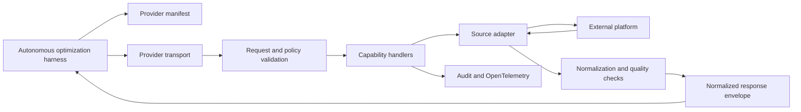

# Optimization provider architecture

## Status

This document defines the architecture for a standalone provider that connects the autonomous optimization harness to a source-specific FinOps, telemetry, conversation, schema, catalog, or lineage platform.

See the [project plan](./project-plan.md) for implementation phases, backlog, and acceptance criteria.

## Executive summary

The provider is an anti-corruption layer between the harness and an external system. It understands the source platform's authentication, APIs, queries, schemas, units, freshness, and failure modes. It exposes only declared normalized capabilities and never contains generic agent prompts, experiment orchestration, Git branch logic, or customer build commands.

The provider is independently versioned and released. The harness discovers it through a manifest and communicates through one supported transport. Contract tests ensure that providers can be replaced without changing generic agents.

## Goals

- Isolate source-specific behavior from the harness.
- Expose a minimal, capability-based surface.
- Normalize data without hiding material limitations.
- Preserve source attribution, scope, time, units, and confidence.
- Enforce least privilege and bounded queries.
- Support independent release and compatibility testing.
- Provide deterministic fixtures for development.
- Make failures explicit and machine-readable.

## Non-goals

- Generic cost-optimization reasoning.
- Answerability option analysis.
- Customer code changes.
- Experiment deployment.
- Git branches, pull requests, or issues.
- Automatic fallback to fabricated or stale fixtures.
- Unrestricted query or shell execution.
- Combining unrelated source systems merely for convenience.

## Provider boundary

The provider owns:

- Source authentication and connection.
- Configuration schema.
- Supported capabilities.
- Query templates or API calls.
- Source-specific pagination and throttling.
- Unit, currency, time, and identifier normalization.
- Freshness and completeness evaluation.
- Redaction and field allowlists.
- Structured errors and warnings.
- Source fixtures.
- Contract and integration tests.
- Packaging, release, and compatibility metadata.

The provider does not own:

- Harness scheduling or checkpoints.
- Generic agent behavior.
- Customer workload requirements.
- Baseline-versus-candidate experiments.
- Git operations.
- Decision-record rendering.
- Production-change approval.

## Logical architecture



## Recommended repository structure

```text
optimization-provider/
  src/
    entrypoint/
    capabilities/
    source/
      client/
      queries/
      mappings/
    normalization/
    configuration/
    security/
    telemetry/
    errors/
  schemas/
    config.schema.json
    responses/
  fixtures/
    source/
    normalized/
  tests/
    unit/
    contract/
    integration/
  provider.yaml
  Dockerfile
  package.json
  README.md
```

The language can follow the source ecosystem. TypeScript, .NET, Python, Go, or Java are acceptable if the provider can meet the transport, schema, packaging, and contract requirements.

## Provider manifest

```yaml
apiVersion: optimization-harness.io/v1
kind: Provider
metadata:
  name: example-finops-provider
  version: 1.0.0
  description: Provides normalized FinOps capabilities from Example Platform.
spec:
  harnessCompatibility: ">=1.0.0 <2.0.0"
  capabilities:
    - finops.cost-summary
    - finops.cost-by-resource
    - finops.current-pricing
  runtime:
    type: container
    image: ghcr.io/example/example-finops-provider:1.0.0
    digest: sha256:...
  configurationSchema: schemas/config.schema.json
  responseSchemas: schemas/responses/
  permissions:
    network:
      - api.example.com
    filesystem: []
  dataClassification:
    maximum: customer-confidential
```

The manifest must declare:

- Provider identity and version.
- Harness compatibility.
- Exact capabilities.
- Runtime and entry point.
- Configuration schema.
- Response schema versions.
- Required network and filesystem access.
- Expected identity mechanism.
- Maximum data classification.

## Capability model

Providers implement only capabilities supported by their source.

### FinOps capabilities

```text
finops.cost-summary
finops.cost-by-resource
finops.recommendations
finops.current-pricing
finops.utilization
finops.estimate-workload-cost
```

### Conversation capabilities

```text
conversation.failed-answer-events
conversation.feedback
conversation.protected-evidence
```

### Data capabilities

```text
data.schema
data.semantic-model
data.catalog
data.lineage
data.query-history
```

### Telemetry capabilities

```text
telemetry.application
telemetry.resource-consumption
telemetry.load-test
```

A provider should not declare a capability until all required fields, error cases, and contract tests are implemented.

## Request envelope

```json
{
  "apiVersion": "optimization-harness.io/v1",
  "requestId": "req-01J...",
  "runId": "run-01J...",
  "capability": "finops.cost-summary",
  "scope": {
    "account": "configured-scope",
    "resourceGroup": "example-rg"
  },
  "timeRange": {
    "start": "2026-09-01T00:00:00Z",
    "end": "2026-10-01T00:00:00Z"
  },
  "parameters": {}
}
```

The provider validates:

- API version.
- Capability declaration.
- Configured scope allowlist.
- Maximum time range.
- Parameter limits.
- Caller authorization when applicable.
- Data classification.

## Response envelope

```json
{
  "apiVersion": "optimization-harness.io/v1",
  "requestId": "req-01J...",
  "provider": {
    "name": "example-finops-provider",
    "version": "1.0.0"
  },
  "source": {
    "system": "example-platform",
    "scope": "configured-scope",
    "observedAt": "2026-10-02T15:00:00Z",
    "dataThrough": "2026-10-01T23:59:59Z"
  },
  "status": "succeeded",
  "data": {},
  "quality": {
    "complete": true,
    "coveragePercent": 100
  },
  "warnings": [],
  "evidence": []
}
```

The provider must not return a success-shaped response when the source operation failed or required evidence is missing.

## FinOps normalization

FinOps responses preserve:

- Billing or usage scope.
- Currency.
- Cost type.
- Charge period.
- Pricing effective period.
- Region and offer when applicable.
- Resource identifier.
- Meter, unit, and quantity.
- Allocation or amortization basis.
- Data freshness.
- Unpriced quantities.

Rules:

- Do not mix currencies silently.
- Do not convert missing prices to zero.
- Do not select an arbitrary price when multiple rates apply.
- Do not present public pricing as negotiated cost.
- Preserve excluded and allocated charges.
- Return warnings when data is partial or stale.

## Conversation normalization

Conversation providers should return sanitized events and protected references rather than unrestricted transcripts.

Required distinctions include:

- Unable to answer.
- Clarification requested.
- Query generation failed.
- Query execution failed.
- Query succeeded with no relevant data.
- Access denied.
- Safety refusal.
- User rejected the answer.

The provider should apply observation windows, pagination, and data minimization before returning events.

## Schema and catalog normalization

Schema providers return metadata needed to evaluate answerability:

- Entities, fields, and types.
- Descriptions and business terms.
- Approved relationships.
- Metrics and semantic definitions.
- Freshness and retention.
- Ownership.
- Classification.
- Lineage.
- Known limitations.

Production row access is not required when metadata can answer the capability request.

## Supported transports

### MCP

Use MCP when a coding-agent runtime needs tool discovery and local or remote tool calls. Expose only declared capability tools. Do not expose a generic query tool unless policy explicitly permits it.

### Executable

Use an executable for local, air-gapped, or scheduler-managed execution. Exchange JSON through files or standard streams and use deterministic exit codes.

### Container

Use a container for portable packaging and dependency isolation. Run as a non-root user with constrained filesystem and network access.

### HTTPS

Use HTTPS for centrally operated providers. Require authentication, authorization, request limits, audit logs, and tenant isolation.

One release should have one primary supported transport. Additional transports must preserve identical capability semantics.

## Authentication

Preferred mechanisms:

- Workload identity federation.
- Managed identity.
- Platform-native short-lived tokens.
- User authentication for local read-only development.

Avoid:

- Embedded credentials.
- Long-lived client secrets.
- Credentials in configuration files.
- Sharing provider identities with experiment deployment.

## Query and API safety

- Use curated query templates.
- Bind validated parameters.
- Apply scope and time limits.
- Limit returned fields and rows.
- Handle throttling explicitly.
- Redact sensitive fields.
- Record query-template versions.
- Prevent prompt content from becoming executable query syntax.
- Do not expose arbitrary SQL, KQL, shell, or cloud commands by default.

## Error model

Structured error categories:

```text
invalid-request
unsupported-capability
scope-denied
authentication-failed
authorization-failed
source-unavailable
source-throttled
source-schema-changed
stale-data
incomplete-data
normalization-failed
contract-violation
internal-error
```

Errors include:

- Request ID.
- Provider name and version.
- Category.
- Retryability.
- Safe message.
- Diagnostic reference.

Do not include credentials, raw protected content, or source response bodies in ordinary errors.

## Observability

Emit OpenTelemetry for:

- Capability and handler.
- Provider version.
- Source operation.
- Duration.
- Rows or records considered.
- Throttling and retries.
- Quality status.
- Error category.

Do not emit query text, prompts, credentials, or protected evidence unless an approved diagnostic mode stores them securely.

## Packaging and release

Every release should include:

- Provider manifest.
- Runtime artifact.
- Configuration and response schemas.
- Contract fixtures.
- Checksums.
- Software bill of materials.
- Changelog.
- Compatibility declaration.
- Setup and least-privilege guidance.

Sign artifacts where the distribution platform supports it. Pin mutable dependencies in production builds.

## Testing

### Unit tests

- Configuration validation.
- Parameter limits.
- Scope enforcement.
- Source mappings.
- Unit and currency normalization.
- Freshness and quality rules.
- Redaction.
- Error mapping.

### Contract tests

- Manifest validation.
- Every declared capability.
- Success, warning, empty, partial, stale, denied, throttled, and failed responses.
- Unsupported API versions.
- Schema compatibility.

### Integration tests

- Real authentication in a test environment.
- Representative source queries or API calls.
- Pagination.
- Throttling.
- Source schema changes.
- Tenant and scope isolation.

## Definition of done

The provider is complete when:

- Its manifest validates.
- Every declared capability passes shared contract tests.
- Configuration and scope are validated before source access.
- Required source limitations are visible in normalized responses.
- Missing data never appears as zero or success.
- Authentication uses an approved identity mechanism.
- Logs and errors contain no credentials or protected content.
- The release artifact is independently installable.
- The harness can replace a mock provider with this provider without agent changes.
- The provider repository is not required at runtime.
